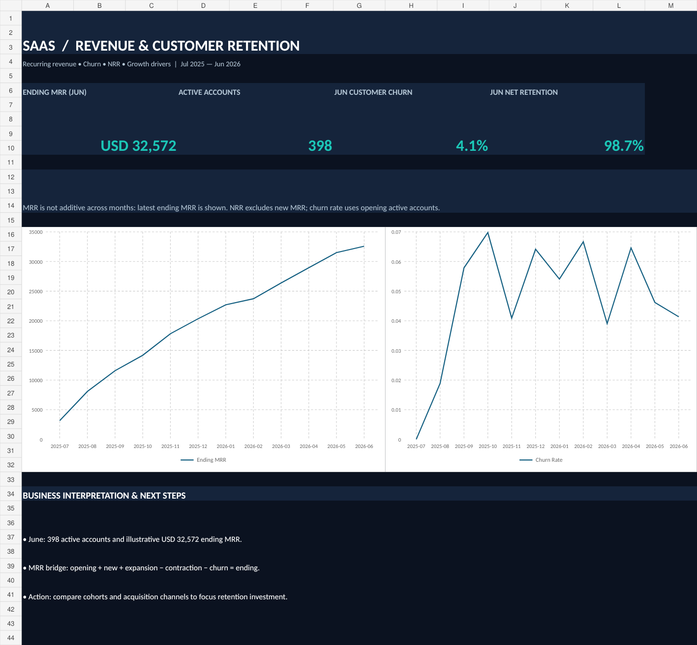

# SaaS Subscription Growth & Churn | Power BI + Excel + SQL

> **Portfolio simulation — all data is synthetic.** Monetary amounts are illustrative USD, not observed revenue.

**Business question:** How fast are subscriptions growing, how much recurring revenue is being lost to churn, and do retained customers expand their spend?

**Data:** 550 simulated subscriber accounts, 3,436 account-month snapshots, 3 plans, Jul 2025–Jun 2026.

**KPIs:** monthly recurring revenue (MRR), month-over-month growth, customer churn %, net revenue retention (NRR), gross revenue retention (GRR), ARPA, plan mix, cohort retention.

**Starter dashboard:** `SaaS_Excel_Dashboard.xlsx`; `powerbi/Build_Guide.md` and `powerbi/Measures.dax` for Power BI; `analysis.db` for SQLite; query file `sql/02_business_queries.sql`.

### Exact business logic
- Every account starts once, may upgrade/downgrade, and may churn once (no reactivations in this simulation).
- **MRR bridge:** Ending MRR = Opening MRR + New MRR + Expansion MRR − Contraction MRR − Churn MRR.
- **Churn %:** accounts that churned in month ÷ accounts active at **start** of that month.
- **NRR:** (Opening MRR + Expansion − Contraction − Churn MRR) / Opening MRR. New MRR **excluded**.
- MRR is a **point-in-time balance**; do not add MRR from different months to get a yearly number.

### Sample finding (synthetic)
- Ending MRR in Jun 2026: USD 32,572.
- Active accounts in Jun 2026: 398.
- Latest month NRR: 98.7%.

### Use
1. Open the Excel dashboard to explore the KPI story.
2. Build your Power BI report using the model and DAX setup guide, then save your `.pbix` and add screenshots.
3. Run the provided SQL in `analysis.db` to validate the monthly MRR bridge and cohort churn.
